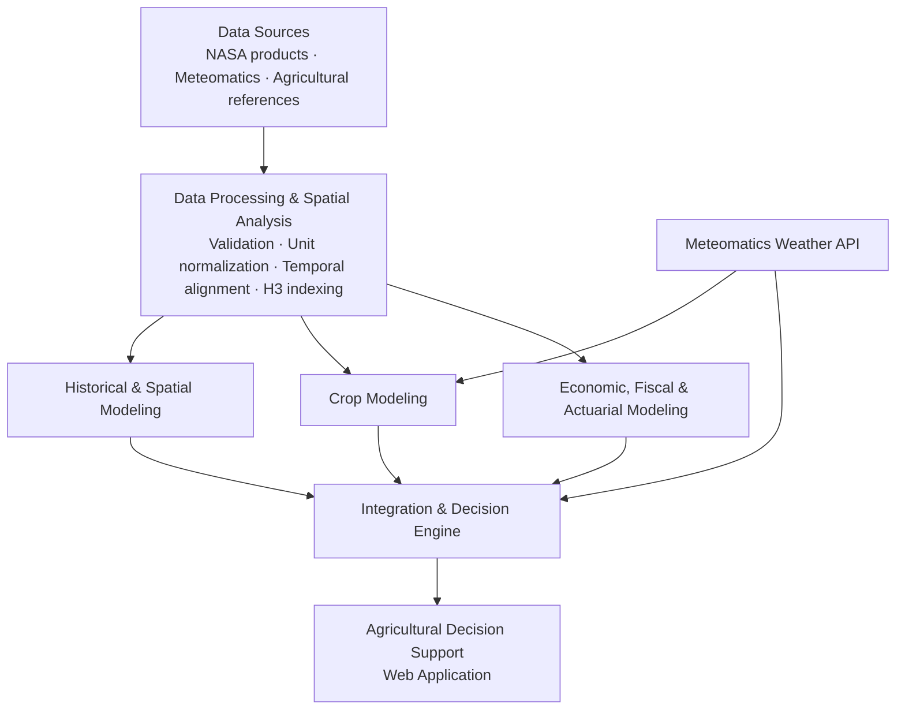

# CYBER-KATAM

**Closed-Loop Dynamic Transition-Window Governance & Fiscal-Actuarial Clearing Engine**

CYBER-KATAM is an integrated, data-driven agricultural decision support system that improves how agricultural transitions are evaluated, planned, and managed. It combines NASA Earth observation data, geospatial analysis, crop modeling, external weather forecasts from Meteomatics, and economic, fiscal, and actuarial assessments.

The system connects environmental monitoring with crop suitability, water-balance calculations, multi-season crop rotation planning, and short-term agricultural advisories. Its Integration & Decision Engine brings these outputs together to evaluate transition opportunities while considering environmental constraints, resource availability, and financial implications. The pilot area is **Banyumas, Central Java, Indonesia**.

> CYBER-KATAM supports human decision-making. It does not replace farmers' experience and does not guarantee agricultural outcomes.

---

## Table of Contents

- [Overview](#overview)
- [Problem Statement](#problem-statement)
- [Project Objectives](#project-objectives)
- [System Architecture](#system-architecture)
- [Data Sources and Resources](#data-sources-and-resources)
- [Data Processing and Spatial Framework](#data-processing-and-spatial-framework)
- [Modeling Methodology](#modeling-methodology)
  - [Historical & Spatial Modeling](#historical--spatial-modeling)
  - [Crop Modeling](#crop-modeling)
  - [Economic, Fiscal & Actuarial Modeling](#economic-fiscal--actuarial-modeling)
- [External Weather Forecast Integration](#external-weather-forecast-integration)
- [Integration & Decision Engine](#integration--decision-engine)
- [Explainability and Human Verification](#explainability-and-human-verification)
- [Innovation and Creativity](#innovation-and-creativity)
- [Intended Impact](#intended-impact)
- [Limitations and Future Development](#limitations-and-future-development)
- [Tech Stack](#tech-stack)
- [Acknowledgements](#acknowledgements)

---

## Overview

CYBER-KATAM addresses the interconnected challenges faced by farmers and agricultural stakeholders: soil moisture variability, environmental stress, crop suitability, water availability, crop rotation planning, extreme weather risks, fertilizer requirements, and financial feasibility.

Rather than analyzing these factors independently, it connects them through a modular architecture. Environmental and agricultural data are processed by three main modeling modules:

1. **Historical & Spatial Modeling**
2. **Crop Modeling**
3. **Economic, Fiscal & Actuarial Modeling**

External weather forecasts are retrieved from Meteomatics through its Weather API, provided as a resource for NASA Space Apps Challenge participants. Outputs are combined by the **Integration & Decision Engine** and presented through a web application for farmers and other stakeholders.

The architecture is designed to be adaptable to other agricultural regions when relevant local data and parameters are available.

## Problem Statement

Agricultural decisions involve multiple interconnected factors. A crop may suit an area but need more water than is available; a rotation strategy may bring soil benefits but add production costs; a field may look healthy from satellite vegetation indicators while experiencing underlying water stress. These are hard to address with a single dataset or method. Key problems include:

- Limited integration of environmental, agronomic, meteorological, and economic information.
- Differences in soil moisture and land characteristics across locations.
- Uncertainty in water availability and short-term weather.
- Difficulty evaluating alternative crop sequences over multiple growing seasons.
- Potential soil degradation and erosion during exposed or fallow periods.
- Fertilizer requirements and the relationship between crop rotation and nutrient management.
- Financial and agricultural insurance risks associated with farming decisions.

## Project Objectives

- Integrate NASA Earth observation data, satellite-derived indicators, agricultural references, local information, and external weather forecasts.
- Analyze environmental and spatial conditions across agricultural areas.
- Evaluate crop suitability, crop water requirements, planting calendars, and crop rotation alternatives.
- Support short-term operational decisions using external weather forecasts.
- Estimate potential economic, fiscal, fertilizer-related, and agricultural insurance implications.
- Combine outputs from different modules into interpretable decision support.
- Present results through an accessible web application.
- Preserve data provenance, uncertainty, and missing-information status to avoid unsupported recommendations.

## System Architecture



| Layer | Role |
|---|---|
| Data Processing & Spatial Analysis | Validates data, normalizes units, aligns timestamps, processes spatial boundaries, and indexes data with H3. |
| Modeling Modules | Three modules: Historical & Spatial, Crop, and Economic/Fiscal/Actuarial. |
| External Weather Forecast | Meteomatics forecasts consumed by Crop Modeling (Tactical Crop Advisory) and the Decision Engine. |
| Integration & Decision Engine | Checks input sufficiency and combines module outputs into decision-support results. |
| Web Application | Presents insights and recommendations to farmers and stakeholders. |

## Data Sources and Resources

### NASA and Satellite Data

| # | Product | Main Variables | Application |
|---|---|---|---|
| 1 | NASA SMAP L4 Soil Moisture (SPL4SMGP) | Surface and root-zone soil moisture | Soil moisture condition and water-stress context |
| 2 | NASA MODIS Land Surface Temperature (MOD11A1) | Land Surface Temperature (LST) | Thermal condition and environmental stress analysis |
| 3 | NASA GPM IMERG (V07) | Precipitation | Rainfall patterns, water inputs, rainfall-related hazards |
| 4 | NASA HLS (Harmonized Landsat-Sentinel) | Surface reflectance, NIR, Red, SWIR | Vegetation and bare-soil indicators |
| 5 | NASA SRTM (SRTMGL1) | Elevation | Terrain and slope analysis |
| 6 | NASA POWER Agro-Climatology | Meteorological and agroclimatological variables | Agro-climate calculations, reference evapotranspiration inputs |
| 7 | Google Earth Engine | Satellite data access and geospatial processing | Satellite data processing and geospatial analysis |

### Space Agency Partner & Other Data

- **ESA WorldCover** (Land Cover, 10 m)
- **Uber H3** Geospatial Indexing
- **Meteomatics** Weather Forecast (NASA Space Apps Challenge partner)

### External Weather Data

Forecasts come from the Meteomatics Weather API, a REST-style API for forecast, current, and historical data. Requests specify forecast time, weather parameters, geographic coordinates, and response format.

### Agricultural and Scientific References

- [Uber H3](https://h3geo.org/): hexagonal hierarchical geospatial indexing
- [FAO-56 Crop Evapotranspiration](https://www.fao.org/4/x0490e/x0490e00.htm)
- [Leaflet](https://leafletjs.com/): interactive maps library

### Initial Crop Registry

| Crop | Variety | Notes |
|---|---|---|
| Rice | Inpari 32 | Released 2013; one of Indonesia's most popular varieties; high yield, resistant to bacterial leaf blight, cooks into soft, fluffy rice (*pulen*). |
| Soybean | Anjasmoro | Released 2001; large yellow seeds ideal for tempeh and tofu; strong stems resist lodging in heavy rain or wind. |
| Mungbean | Vima-1 | Fast-growing (harvest in under two months) with uniform ripening, avoiding repeated pod picking. |
| Sorghum | n/a | n/a |

Crop information includes growth duration, crop coefficients, growth stages, water requirements, and other agronomic parameters where evidence is available. **Reference values are distinguished from locally calibrated values**: for example, a generic FAO rice crop coefficient is not automatically treated as a measured Inpari 32 coefficient for Banyumas.

## Data Processing and Spatial Framework

The system receives datasets with different spatial resolutions, temporal frequencies, coordinate systems, and units. The processing layer:

1. Acquires data from NASA products, external APIs, and agricultural references.
2. Checks data quality and availability.
3. Normalizes units and variable names.
4. Aligns observation timestamps and forecast periods.
5. Processes geographic coordinates and spatial boundaries.
6. Associates data with the relevant H3 spatial cells.
7. Preserves metadata, provenance, and missing-value status.
8. Provides standardized inputs to the modeling modules.

### H3 Spatial Indexing

H3 converts geographic locations into hexagonal cells, giving different spatial datasets a common identifier. It can organize soil moisture, vegetation, rainfall, terrain, crop suitability, and economic/agricultural attributes, and the specification considers multiple H3 resolutions for localized and regional analysis.

> H3 does **not** increase the original resolution of satellite data. A coarse satellite observation assigned to a finer H3 cell must not be presented as a direct field-level measurement.

## Modeling Methodology

CYBER-KATAM combines physical equations, agronomic rules, deterministic candidate generation, and multi-objective optimization. It is **not** a single machine-learning model that predicts every agricultural outcome.

### Historical & Spatial Modeling

Analyzes environmental conditions and spatial differences: soil moisture assessment, vegetation condition, thermal stress, bare-soil exposure, terrain and slope, pre-visual root-stress assessment, and bare-field environmental hazard assessment.

#### Pre-Visual Root-Stress Score (PVRS)

PVRS aims to identify possible physiological or root-zone water stress before visible vegetation deterioration. It combines the Evaporative Stress Index (ESI), Land Surface Temperature (LST), and root-zone soil moisture.

```text
S_physio = w1 × ((μ_ESI − ESI) / σ_ESI)
         + w2 × ((LST − μ_LST) / σ_LST)
         + w3 × ((μ_SM − SM_root) / σ_SM)

S_visual = (μ_NDVI − NDVI) / σ_NDVI

PVRS = 1 / (1 + exp[−(S_physio − γ × S_visual)])
```

Where μ is a historical mean, σ a historical standard deviation, w1–w3 are component weights, and γ controls the vegetation contribution. Proposed values: `w1 = 0.35`, `w2 = 0.35`, `w3 = 0.30`, `γ = 0.50`.

The formulation is project-specific and requires suitable input data, historical baselines, and validation before being treated as a calibrated stress prediction.

#### Modified Bare Soil Index (MBSI)

```text
MBSI = (SWIR1 − SWIR2 − NIR) / (SWIR1 + SWIR2 + NIR)
b_it = clip((MBSI + 0.15) / 0.45, 0, 1)
```

`b_it` is the estimated bare-soil fraction. This transformation is a project-specific implementation assumption and must be calibrated against reference observations before being interpreted as a verified physical fraction.

#### Bare-Field Environmental Hazard and Stress Index (BF-EHSI)

Assesses potential environmental hazards of exposed agricultural land, especially during fallow periods.

```text
BF-EHSI = b_it × [ α × (LST_ECOSTRESS / LST_crit)
                 + β × tan(θ_SRTM) × (R_GPM,95th / R_norm) ]
```

| Symbol | Meaning |
|---|---|
| `b_it` | Estimated bare-soil fraction |
| `LST_ECOSTRESS` | Land surface temperature |
| `LST_crit` | Critical temperature reference |
| `θ_SRTM` | Terrain slope |
| `R_GPM,95th` | 95th-percentile rainfall intensity |
| `R_norm` | Rainfall normalization parameter |
| `α`, `β` | Component weights |

A cumulative degradation-risk formulation is also included:

```text
D_i = Σ [ b_it × k_i × c_it × e_it × Δt ]
```

with `k_i` soil erodibility, `c_it` surface connectivity, `e_it` rainfall erosivity, and `Δt` the time interval.

### Crop Modeling

Six components: **Crop Parameter Registry**, **Crop Water Modeling**, **Crop Suitability**, **Crop Calendar**, **Strategic Crop Rotation Modeling**, and **Tactical Crop Advisory**.

#### Crop Parameter Registry

Stores crop characteristics and supporting references. Each parameter includes crop/variety identifier, value, unit, source, evidence status, and validation information. The registry distinguishes **observed values, reference values, proxies, derived values, and missing information**, so unsupported parameters are never silently replaced with arbitrary defaults.

#### Crop Water Modeling

Follows the FAO-56 crop coefficient approach:

```text
ETc = Kc × ETo

ETo = [0.408Δ(Rn − G) + γ(900 / (T + 273)) u2 (es − ea)]
      / [Δ + γ(1 + 0.34 u2)]

S_t = S_(t−1) + P_eff,t + I_t − ETc_t − RO_t − DP_t
```

| Symbol | Meaning |
|---|---|
| `ETc` / `ETo` | Crop / reference evapotranspiration |
| `Kc` | Stage-specific crop coefficient |
| `Rn`, `G` | Net radiation, soil heat flux |
| `T`, `u2` | Mean air temperature, wind speed at 2 m |
| `es − ea` | Vapor pressure deficit |
| `Δ`, `γ` | Slope of saturation vapor pressure curve, psychrometric constant |
| `S_t` | Soil water storage |
| `P_eff`, `I`, `RO`, `DP` | Effective rainfall, irrigation, runoff, deep percolation |

Short-term forecasts use **sequential forward water-balance** calculations: H+1 uses the initial storage, H+2 uses the resulting H+1 storage, and H+3 uses the H+2 storage. The model distinguishes seasonal crop evapotranspiration from actual irrigation demand.

#### Crop Calendar

Uses crop duration and growth-stage information to support planting-window evaluation, growth-stage tracking, harvest timing estimates, feasibility checks between consecutive seasons, and crop sequence scheduling. Accuracy depends on validated duration and growth-stage parameters.

#### Strategic Crop Rotation Modeling

A deterministic candidate generator creates crop sequences from the registry and checks crop existence and duration, suitability, calendar feasibility, water-related information, other agronomic constraints, and completeness of optimization metrics. Candidates are compared with **multi-objective Pareto analysis**:

```text
Maximize f(x) = [ N_displaced(x), ΔSOC(x), −BPH_burden(x) ]
```

- `N_displaced`: potential chemical nitrogen fertilizer displacement
- `ΔSOC`: change in soil organic carbon
- `BPH_burden`: brown planthopper burden

Constraints cover farmer subsistence income, soil water availability, saturated hydraulic conductivity, and soil erosion tolerance. An epsilon-constraint formulation is also supported:

```text
Maximize N_displaced(x)
subject to  ΔSOC(x) ≥ ε1,  BPH_burden(x) ≤ ε2
```

Candidates with incomplete required metrics are **not** assigned fabricated values and are not included in the final Pareto ranking.

#### Tactical Crop Advisory

Short-term operational advisories using forecast data and environmental information, across: **planting, irrigation, fertilization, drainage, harvest, and fallow management**.

- **Irrigation:** sequential water-balance calculations with forecast information.
- **Fertilization:** requires an explicit nitrogen requirement; biological nitrogen fixation is not automatically subtracted from fertilizer demand.
- **Drainage:** evaluates soil moisture and saturation; rainfall alone is insufficient to establish a drainage need.
- **Planting / harvest:** considers crop duration and planting dates when available.
- **Fallow management:** consumes a BF-EHSI value supplied by the spatial module rather than recalculating it.

The advisor **abstains** when essential inputs are missing.

### Economic, Fiscal & Actuarial Modeling

Evaluates potential financial and policy implications: nitrogen accounting, fiscal subsidy scenarios, agricultural insurance risk, and economic feasibility.

#### A. Three-Tier Nitrogen Accounting

```text
Tier 1:  N_bio      = Biomass × Tissue_N × Ndfa
Tier 2:  N_retained = N_bio × (1 − f_harvest) × (1 − f_denit − f_leach) × f_mineralization
Tier 3:  ΔN_chem    = min( N_retained / (0.46 × NUE), Urea_recommended )
```

`0.46` is the nominal nitrogen fraction of urea; `NUE` is nitrogen-use efficiency. Retained nitrogen does not automatically equal actual fertilizer savings, since residue decomposition, soil nitrogen, mineralization timing, immobilization, crop uptake, and field-specific response must be considered.

#### B. Fiscal Subsidy Clearing

```text
S_net = Σ [ A_k × a_k × ΔN_chem,k × s_N ] − (C_extension + C_transition + C_verification)
```

`A_k` agricultural area, `a_k` adoption ratio, `ΔN_chem,k` potential fertilizer displacement, `s_N` assumed subsidy difference per kg, and `C_*` extension, transition, and verification costs. This estimates potential fiscal implications under adoption scenarios; it is **not** a measurement of realized government budget savings.

#### C. Agricultural Insurance Risk Assessment

Examines how management strategies (water management, rotation, pest exposure) may influence crop failure risk, including AUTP-related risks. A valid actuarial assessment requires historical claim frequency and severity, insured area, sum insured, coverage and eligibility rules, and historical loss and payment information. Without these, percentage reductions from assumed coefficients are **scenario estimates**, not validated predictions.

#### D. Economic Feasibility

```text
Gross Margin = Revenue − Production Cost
Revenue      = Yield × Selling Price
```

Analysis must use crop-specific, regionally relevant values. Historical or assumed prices must not be presented as current market prices.

#### E. Optimization Integration

Economic and actuarial outputs supply additional metrics for comparing rotation scenarios. To avoid duplicate logic, the system uses **one canonical Pareto optimization workflow**.

## External Weather Forecast Integration

CYBER-KATAM uses the Meteomatics Weather API as an external forecast source. The team does **not** develop an independent forecasting model.

Integration workflow:

1. Request forecast information for the required location and period.
2. Retrieve the selected weather parameters.
3. Parse and validate the API response.
4. Convert it into the standardized `ForecastBundle` and `ForecastDay` structures.
5. Pass it to Crop Modeling and the Integration & Decision Engine.
6. Use it for short-term agricultural advisory calculations.

The API provides meteorological data; the agricultural interpretation and recommendation logic are handled by CYBER-KATAM.

## Integration & Decision Engine

Combines historical environmental indicators, spatial and terrain information, crop suitability and water-balance outputs, rotation candidates, economic and fiscal metrics, and weather forecasts. It evaluates completeness and compatibility of inputs before generating results, and distinguishes **validated recommendations**, **conditional recommendations**, and **insufficient-data cases**.

The project follows a **fail-closed** approach:

- Complete and sufficiently validated inputs may support an advisory.
- Incomplete inputs result in conditional outputs or abstention.
- Assumptions and proxies are explicitly identified.
- Field verification is required when important conditions cannot be established remotely.

## Explainability and Human Verification

A decision-support result can include:

- **Evidence:** environmental and agronomic indicators supporting the result.
- **Expected Benefits:** potential water, soil, crop, or economic benefits.
- **Information Gaps:** missing or uncertain parameters affecting confidence.
- **Local Risks:** conditions requiring field inspection or additional verification.

Human-in-the-loop verification involves farmers, farmer groups, and agricultural extension officers, which is especially important for field-level information satellites cannot reliably establish, such as soil pH, drainage capacity, salinity, and actual irrigation conditions.

## Innovation and Creativity

- Combines satellite-derived environmental indicators with crop-specific agronomic requirements.
- Uses H3 spatial indexing to connect data from different geographic sources.
- Treats crop rotation as a multi-objective decision across soil, nutrient, pest, and economic trade-offs.
- Connects external weather forecasts with sequential crop water-balance calculations.
- Considers fiscal and agricultural insurance implications alongside agronomic decisions.
- Builds missing-data handling, evidence status, and human verification into the workflow.
- Modular architecture lets components be improved without redesigning the whole system.

## Intended Impact

- **Farmers:** evaluate crop choices, water requirements, planting schedules, and rotation alternatives.
- **Extension officers:** structured overview of environmental indicators, risks, and conditions needing field verification.
- **Policymakers and stakeholders:** evaluate resource efficiency, fertilizer subsidy implications, and agricultural risk management.

Long-term goals: better-informed crop planning, improved awareness of water constraints, systematic evaluation of rotation alternatives, greater consideration of soil and environmental risks, more transparent economic and fiscal trade-off assessment, better communication among farmers, extension officers, and policymakers, and support for sustainable, resilient agriculture.

## Limitations and Future Development

- Satellite observations have varying resolutions and cannot automatically provide field-level measurements; downscaling requires documented methods and validation.
- Some crop parameters come from general references or proxies; local calibration is needed before strong claims about crop performance in Banyumas.
- Fiscal and actuarial calculations require verified local prices, production costs, subsidy regulations, insurance rules, and historical claim data.
- Weather forecasts are not equivalent to historical satellite observations and must be handled separately.
- The Decision Engine must only generate recommendations when required inputs are sufficiently complete and reliable.

**Future work:** verified data ingestion, local parameter calibration, field validation, economic and actuarial integration, complete API connectivity, and runtime integration of all modeling modules.

## Tech Stack

- **Python** and scientific computing libraries: data processing, numerical calculations, geospatial analysis, and crop, environmental, and economic models.
- **React / JavaScript:** web application interface.
- **Leaflet:** interactive map visualization.
- **Uber H3:** hexagonal spatial indexing.
- **JSON / GeoJSON:** model inputs and outputs, configuration, parameters, and geospatial features.
- **Google Earth Engine:** satellite data access and processing.
- **Meteomatics Weather API:** external weather forecasts.

## Acknowledgements

Built for the **NASA Space Apps Challenge**. Data and resources: NASA SMAP, MODIS, GPM IMERG, HLS, SRTM, NASA POWER, Google Earth Engine, ESA WorldCover, Uber H3, FAO-56, and Meteomatics (NASA Space Apps Challenge partner).

Repository: <https://github.com/NASA-satset-team/cyber-katam>
